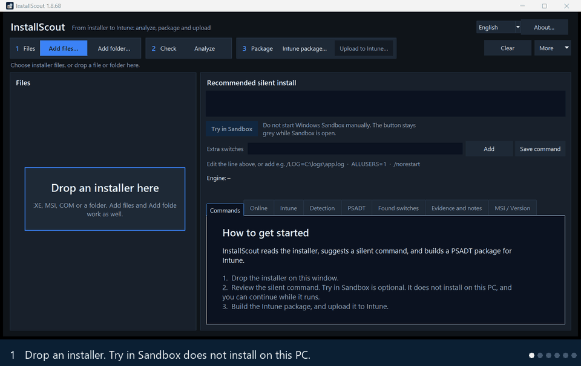

# InstallScout

Public page: [mthorngaard.github.io/InstallScout-releases](https://mthorngaard.github.io/InstallScout-releases/)

Find silent install switches for a Windows app without running the installer. InstallScout reads an EXE, MSI, COM, or MSIX, names the engine, and writes the silent command. It can then build a PSAppDeployToolkit (PSADT) `.intunewin` package and upload the Win32 app to Microsoft Intune.

**New in 1.8.59 — Try in Sandbox.** After Analyze, the button runs the silent command and the detection script in Windows Sandbox. Nothing is installed on this PC. It appears when Windows Sandbox is installed.

## What it does

- **Silent command** — names the engine (Inno, NSIS, MSI, InstallShield, WiX Burn, Squirrel, and others) and writes the install line. The installer is not run.
- **Try in Sandbox** — runs that command and the detection script in Windows Sandbox, so this PC is not changed. Shown when Windows Sandbox is installed.
- **Your edit** — change the line, add a switch, or tick a suggested one before anything is packaged.
- **Online check** — looks up the product name in WinGet and Chocolatey. The file is not uploaded.
- **System or User** — chosen from the engine and the command.
- **Intune package** — a local `.intunewin` with PSADT, install, uninstall, and detection.
- **Upload** — the Win32 app in Intune, with a logo and optional supersedence.

Windows 10 and 11. The interface is in English. Switch to Dansk in the top-right corner.

## Download

The current version is **1.8.59**: [releases](https://github.com/mthorngaard/InstallScout-releases/releases/latest)

| File | Use |
|---|---|
| [`InstallScout-1.8.59.zip`](https://github.com/mthorngaard/InstallScout-releases/releases/download/v1.8.59/InstallScout-1.8.59.zip) | Both files in one download. |
| `InstallScoutPortable.exe` | Copy it anywhere and run it. Nothing is installed. |
| `InstallScout.msi` | Installs to Program Files and adds a Start menu shortcut. |

The download is not code-signed. Windows or company security may warn or block it. Choose Keep / Run anyway, ask IT to allow the file, or try it in a VM or Windows Sandbox without those policies.

Drop an installer on the window, or use **Add files**. **Try in Sandbox** runs the command without installing on this PC. You can still test the package in a VM before you roll it out.

## Prerequisites

Windows 10 or Windows 11. Finding silent switches and building a local package does not need an Azure sign-in.

Upload to Intune also needs:

- Microsoft Edge. Sign-in opens in an Edge profile.
- An account that can create Win32 apps. In Microsoft Entra, that is the **Intune Administrator** role. In Intune role-based access control, **Application Manager** is enough. A custom role with the same app permissions works too.
- One-time admin consent in the tenant for the Graph permission `DeviceManagementApps.ReadWrite.All`. Sign-in uses the public Microsoft Graph PowerShell client unless you set another Client ID. InstallScout does not create an app registration.
- Conditional Access can still block that sign-in.

## Documentation

**Find silent switches:** [English](https://mthorngaard.github.io/InstallScout-releases/docs/find-silent-switches.html) · [Dansk](https://mthorngaard.github.io/InstallScout-releases/docs/find-silent-switche.html)  
**Quick start:** [English](https://mthorngaard.github.io/InstallScout-releases/docs/quickstart-en.html) · [Dansk](https://mthorngaard.github.io/InstallScout-releases/docs/quickstart.html)  
**Guide:** [English](https://mthorngaard.github.io/InstallScout-releases/docs/guide.html) · [Dansk](https://mthorngaard.github.io/InstallScout-releases/docs/vejledning.html)  
**Technical reference:** [English](https://mthorngaard.github.io/InstallScout-releases/docs/reference-en.html) · [Dansk](https://mthorngaard.github.io/InstallScout-releases/docs/reference.html)

PDF copies sit next to the Markdown files: [quick start](docs/InstallScout-quickstart-en.pdf), [guide](docs/InstallScout-guide.pdf), and [reference](docs/InstallScout-reference-en.pdf). Danish PDF files use the same names without `-en`.

## Credits

Intune packages are built with [PSAppDeployToolkit](https://github.com/PSAppDeployToolkit/PSAppDeployToolkit) 4.1.8 by the PSAppDeployToolkit Team. That toolkit is licensed under the [GNU Lesser General Public License v3.0](https://github.com/PSAppDeployToolkit/PSAppDeployToolkit/blob/main/COPYING.Lesser).

Inner setup unpacking uses [7-Zip](https://www.7-zip.org/) Extra (`7za`) by Igor Pavlov, licensed under the GNU LGPL.
